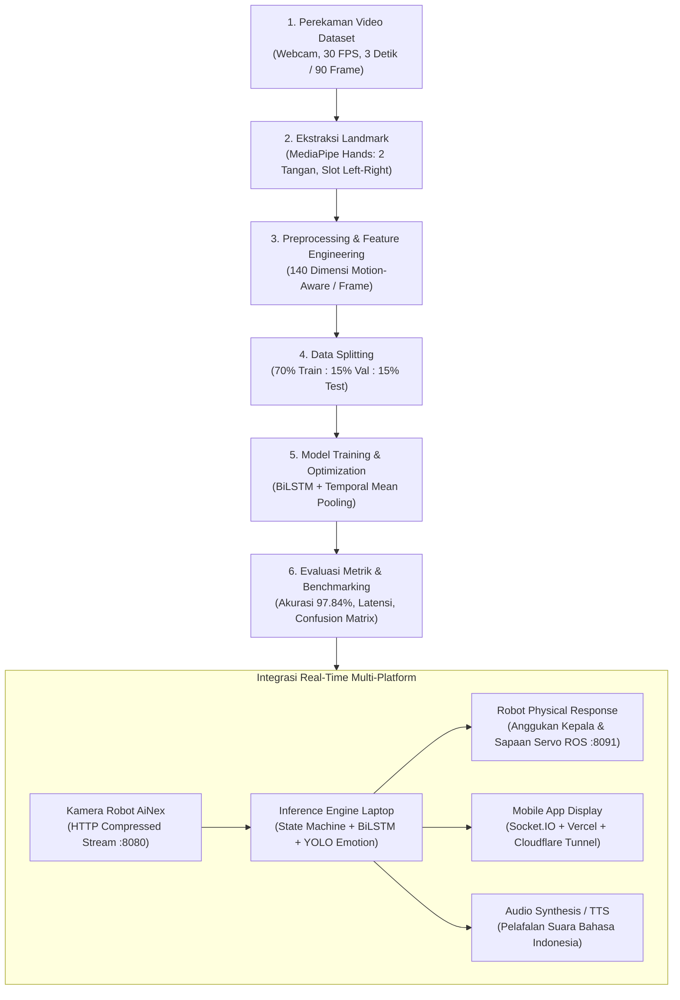

# SLIDE DECK PROGRESS BIMBINGAN CAPSTONE DESIGN / TUGAS AKHIR
# Proyek: Robot Asistif Sosial Penerjemah Bahasa Isyarat Indonesia (BISINDO) & Ekspresi Wajah Berbasis AiNex Humanoid

---

## SLIDE 1: JUDUL & INFORMASI PROYEK
### Pengembangan Robot Sosial Humanoid Asistif Berbasis Pengenalan Bahasa Isyarat (36 Kelas) dan Respons Multimodal
- **Topik Capstone**: Computer Vision, Deep Learning, Human-Robot Interaction (HRI), & Internet of Robotic Things (IoRT).
- **Platform Utama**:
  - Robot Humanoid AiNex (Raspberry Pi 4B, ROS Noetic, Ubuntu 20.04).
  - Laptop Compute Unit (NVIDIA GeForce RTX 3050 Laptop GPU).
  - Web/Mobile App Display (Next.js/React di Vercel, Socket.IO, Cloudflare Tunnel).
- **Tujuan Sistem**: Membantu komunikasi inklusif bagi penyandang disabilitas rungu/wicara dengan menerjemahkan alfabet & kosakata isyarat secara real-time disertai interaksi sosial robotik (gerak gestur robot, suara, dan aplikasi mobile).

> **Poin Bimbingan**: Fokus konsultasi hari ini mencakup progres menyeluruh dari pipeline pengumpulan data, rekayasa fitur 140 dimensi, pelatihan BiLSTM 36 kelas, hasil evaluasi performa, hingga integrasi aktual ke hardware robot AiNex dan aplikasi mobile.

---

## SLIDE 2: ALUR KERJA SISTEM MENYELURUH (END-TO-END PIPELINE)
### Diagram Alur dari Input Sensorik hingga Aksi Fisik & Output Multimodal



---

## SLIDE 3: TAHAP 1 — PENGUMPULAN DATASET (DATA COLLECTION)
### Strategi Akuisisi Data Isyarat Dinamis & Statis
1. **Cakupan Kelas (36 Kelas Terpadu)**:
   - **26 Alfabet Isyarat (A – Z)**: Mewakili ejaan jari (*fingerspelling*) untuk nama, istilah asing, atau singkatan.
   - **10 Kosakata Isyarat Dinamis**: *Apa, Bagaimana, Baik, Belajar, Halo, Kamu, Kita, Makan, Melihat, Saya*.
2. **Spesifikasi Teknis Pengambilan Video**:
   - **Alat**: Modul perekam otomatis berbasis Python (`auto_recorder.py`) dengan verifikasi frame rate.
   - **Durasi per Sampel**: Tepat 90 frame pada 30 FPS (durasi tepat 3.0 detik).
   - **Resolusi**: 640×480 piksel (aspek rasio 4:3 terstandarisasi).
   - **Protokol Perekaman**: Terdapat jeda *countdown* 2 detik sebelum perekaman untuk memastikan gestur dimulai dari posisi awal yang natural.
3. **Kuantitas Dataset**:
   - **60 sampel video per kelas** yang diambil secara konsisten.
   - Total keseluruhan dataset: **36 kelas × 60 sampel = 2.160 video**.

---

## SLIDE 4: TAHAP 2 — EKSTRAKSI LANDMARK (MEDIAPIPE HANDS)
### Transformasi Video Mentah Menjadi Titik Koordinat Spasial

1. **Framework Ekstraksi**: Google MediaPipe Hands (`min_detection_confidence=0.5`, `min_tracking_confidence=0.5`).
2. **Topologi Sendi**:
   - 21 titik sendi 3D (X, Y, Z) per tangan.
   - Mendukung pelacakan hingga 2 tangan secara simultan (`max_num_hands=2`).
3. **Mekanisme Slot Tetap Berdasarkan Handedness (Left/Right)**:
   - Masalah umum pada video isyarat: urutan deteksi tangan sering bertukar (*swapping*) jika tangan kiri dan kanan bergerak bersamaan.
   - **Solusi**: Dibuat pemetaan slot deterministik berdimensi `(42, 3)` per frame:
     - Indeks 0 – 20: Selalu dialokasikan untuk Tangan Kiri (*Left Hand*).
     - Indeks 21 – 41: Selalu dialokasikan untuk Tangan Kanan (*Right Hand*).
     - Jika tangan tertentu tidak tampak pada frame, slot tersebut diisi matriks nol (*zero-padding*).
4. **Format Penyimpanan**:
   - Disimpan dalam file binary NumPy (`.npy`) per video dengan format shape: `(num_frames, 42, 3)`.

---

## SLIDE 5: TAHAP 3 — REKAYASA FITUR (140-DIMENSIONAL MOTION-AWARE FEATURES)
### Solusi Menggabungkan Alfabet Statis dan Kata Dinamis Tanpa Bias Skala & Posisi

Mengapa tidak memakai koordinat mentah MediaPipe? Koordinat mentah sangat rentan terhadap jarak orang ke kamera dan perpindahan posisi badan. Oleh karena itu, dirancang **140 fitur per frame** (70 fitur per tangan):

| Komponen Fitur | Dimensi | Deskripsi Teknis | Manfaat untuk Model |
| :--- | :---: | :--- | :--- |
| **Local Shape (Wrist-Relative)** | **63** | Koordinat seluruh 21 sendi dikurangi koordinat pergelangan tangan ($P_i - P_{wrist}$), lalu dinormalisasi terhadap panjang telapak tangan (jarak wrist ke sendi MCP jari tengah). | Invarian terhadap skala jarak pengguna ke kamera dan ukuran fisik tangan. |
| **Global Wrist Coordinates** | **3** | Posisi absolut pergelangan tangan $(X, Y, Z)$ ternormalisasi pada layar kamera. | Membantu membedakan gestur yang posisi tangannya spesifik (misal: di dada vs di depan wajah). |
| **Wrist Displacement** | **3** | Vektor perpindahan pergelangan tangan terhadap frame awal aktif ($P_{wrist}(t) - P_{wrist}(t_0)$). | **Fitur kunci** untuk menangkap arah ayunan/lintasan kata dinamis (*motion vector*). |
| **Presence Mask** | **1** | Biner (1.0 jika tangan hadir, 0.0 jika tidak ada tangan). | Memberi tahu model apakah gestur satu tangan atau dua tangan. |
| **Total per Tangan** | **70** | $63 + 3 + 3 + 1 = 70$ dimensi | 1 Tangan = 70 fitur |
| **Total 2 Tangan (Input Layer)** | **140** | **Tangan Kiri (70) + Tangan Kanan (70) = 140 Dimensi** | **Input per frame siap inferensi** |

- **Penanganan Dimensi Waktu (Sequence Dimension)**:
  - Setiap sekuens dipotong/dipad ke $T = 90$ frame.
  - Dimensi akhir tensor per sampel: **$[90, 140]$**.

---

## SLIDE 6: TAHAP 4 — STRATIFIKASI & PEMBAGIAN DATASET (DATA SPLIT)
### Pembagian Sampel Seimbang untuk Melatih dan Menguji Model

Seluruh 2.160 sampel dibagi menggunakan teknik *Stratified Train-Validation-Test Split* dengan random seed terkunci (42) guna menjamin reproduksibilitas:

```text
Total Dataset: 2.160 Sampel (36 Kelas × 60 Sampel)
 ├── Training Set   : 70% = 1.512 Sampel (42 sampel / kelas)
 ├── Validation Set : 15% =   324 Sampel ( 9 sampel / kelas)
 └── Testing Set    : 15% =   324 Sampel ( 9 sampel / kelas)
```

- **Training Set (70%)**: Digunakan untuk mengoptimalkan bobot sinapsis model BiLSTM.
- **Validation Set (15%)**: Digunakan untuk pemantauan *loss* per epoch, penjadwalan *learning rate*, dan pemicu *early stopping* agar model tidak *overfitting*.
- **Testing Set (15%)**: Data independen (*unseen data*) yang **sama sekali tidak tersentuh** saat training, murni untuk mengukur generalisasi akhir.

---

## SLIDE 7: TAHAP 5 — ARSITEKTUR MODEL (COMBINED BiLSTM + TEMPORAL POOLING)
### Desain Neural Network untuk Klasifikasi Sekuensial Temporal

```mermaid
graph LR
    In["Input Sequence\n(Batch, 90, 140)"] --> Pack["pack_padded_sequence\n(Dynamic Lengths)"]
    Pack --> LSTM1["BiLSTM Layer 1\n(Hidden Size: 128, Dropout: 0.3)"]
    LSTM1 --> LSTM2["BiLSTM Layer 2\n(Hidden Size: 128, Bidirectional)"]
    LSTM2 --> Unpack["pad_packed_sequence\n(Output: Batch, 90, 256)"]
    Unpack --> Mask["Active Frame Masking"]
    Mask --> Pool["Temporal Mean Pooling\n(Rata-rata Frame Aktif)"]
    Pool --> MLP1["Linear (256 -> 128)\n+ ReLU + Dropout(0.3)"]
    MLP1 --> MLP2["Linear (128 -> 36 Classes)\n(Output Logits)"]
```



### Keunggulan Arsitektur Ini:
1. **Bidirectional LSTM (2 Layer, 128 Hidden Units)**:
   - Membaca sekuens maju (*forward*) dan mundur (*backward*) sehingga mengenali gestur berdasarkan konteks awal hingga akhir gerakan. Output dimensi menjadi $128 \times 2 = 256$.
2. **Temporal Mean Pooling**:
   - Mengambil rata-rata representasi fitur tersembunyi hanya pada frame aktif (*valid lengths*).
   - Mampu menangani alfabet statis (yang tidak banyak bergerak) sekaligus kata dinamis (yang memiliki trajektori dinamis) secara simultan.
3. **Efisiensi Parameter**:
   - Total parameter hanya **~707.000 parameter** (~2.8 MB bobot model).
   - Sangat ringan sehingga inferensi pada laptop RTX 3050 maupun mini PC dapat berjalan di atas 30 FPS.

---

## SLIDE 8: HIPERPARAMETER & STRATEGI PELATIHAN (TRAINING REGIME)
### Parameter Pelatihan & Mekanisme Anti-Overfitting

- **Framework**: PyTorch dengan akselerasi CUDA.
- **Batch Size**: 32 sampel per iterasi.
- **Loss Function**: `CrossEntropyLoss` (standar multi-class classification).
- **Optimizer**: Adam (`learning_rate = 0.001`, `weight_decay = 0.0001` untuk regulasi L2).
- **Learning Rate Scheduler**: `StepLR` (step size = 15 epoch, $\gamma = 0.5$).
  - Epoch 1–15: $LR = 1.0 \times 10^{-3}$
  - Epoch 16–30: $LR = 5.0 \times 10^{-4}$
  - Epoch 31–45: $LR = 2.5 \times 10^{-4}$
  - Epoch 46–60: $LR = 1.25 \times 10^{-4}$
- **Mekanisme Early Stopping**:
  - `patience = 15 epoch`.
  - Pelatihan berhenti otomatis pada **Epoch ke-57**.
  - Checkpoint bobot terbaik tersimpan di **Epoch ke-42** dengan nilai Validation Loss terendah: **0.0521** dan Akurasi Validasi: **99.69%**.

---

## SLIDE 9: HASIL EVALUASI MODEL PADA DATA UJI (TEST SET RESULTS)
### Pengujian pada 324 Sampel Independen (9 Sampel Tiap Kelas)

| Metrik Evaluasi | Nilai Kinerja | Keterangan |
| :--- | :---: | :--- |
| **Overall Accuracy** | **97.84%** | 317 dari 324 sampel uji berhasil diklasifikasikan dengan benar. |
| **Macro Precision** | **98.13%** | Kemampuan model meminimalkan *false positives*. |
| **Macro Recall** | **97.84%** | Kemampuan model menemukan seluruh gestur yang benar. |
| **Macro F1-Score** | **97.82%** | Keseimbangan harmonis antara presisi dan sensitivitas. |
| **Akurasi Sub-Grup Kata** | **100.00%** | **Sempurna!** Seluruh 10 kata dinamis dikenali tanpa salah (90/90 sampel). |
| **Akurasi Sub-Grup Huruf** | **97.01%** | 227 dari 234 sampel alfabet benar. |
| **Cross-Confusion (Huruf $\to$ Kata)** | **0 Kasus** | Tidak ada satu pun alfabet yang tertukar menjadi kosakata kata. |
| **Cross-Confusion (Kata $\to$ Huruf)** | **0 Kasus** | Tidak ada kosakata kata yang salah diprediksi sebagai huruf. |

> **Catatan Analisis**: Fitur 140 dimensi berhasil memisahkan secara sempurna karakteristik statis alfabet dan karakteristik dinamis kosakata tanpa terjadi kebingungan silang (*zero cross-confusion*).

---

## SLIDE 10: ANALISIS CONFUSION MATRIX & EVALUASI KELAS
### Rincian Performa Per Kelas

1. **Kosakata Kata (10 Kelas)**:
   - *Apa, Bagaimana, Baik, Belajar, Halo, Kamu, Kita, Makan, Melihat, Saya*:
   - **Precision: 100%, Recall: 100%, F1-Score: 100%**.
2. **Alfabet Huruf (26 Kelas)**:
   - 23 kelas alfabet memperoleh presisi/recall sempurna ($100\%$).
   - Minoritas kesalahan klasifikasi terjadi pada huruf-huruf dengan bentuk tangan mirip:
     - **Huruf D vs B**: Huruf D (recall 88.89%), tertukar tipis dengan B.
     - **Huruf E & P**: Huruf E (recall 77.78%) dan P (recall 77.78%) akibat kemiripan lekukan jari saat sudut kamera sedikit miring.
     - **Huruf A & H**: Recall 88.89%.
3. **Kesimpulan Evaluasi**:
   - Model memiliki daya pisang yang sangat tajam. Tingkat akurasi 97.84% pada 36 kelas membuktikan model siap digunakan untuk interaksi waktu nyata (*real-time*).

---

## SLIDE 11: SISTEM INFERENSI WAKTU NYATA (REAL-TIME STATE MACHINE)
### Arsitektur Anti-False Trigger pada Program Pengenalan Kamera

Untuk menghindari sistem menebak secara liar saat pengguna sedang diam atau merapikan tangan, dibangun **Finite State Machine (FSM)**:

```text
[IDLE / READY]
   │  (Tangan diam di layar, motion <= 0.003 -> TIDAK memicu inferensi liar)
   ▼
[MOTION DETECTED]
   │  (Perpindahan tangan > motion_threshold 0.003)
   ▼
[RECORDING BUFFER]
   │  (Mengumpulkan frame sekuensial secara kontinu, min 45 frame)
   ▼
[PERIODIC INFERENCE & VOTING]
   │  (Inferensi tiap 3 frame, window voting 5 prediksi, vote ratio >= 80%, confidence >= 0.80)
   ▼
[RESULT LOCKED & COOLDOWN]
   │  (Hasil dikunci, audio diputar, dikirim ke Robot & Mobile App)
   ▼
[RESUME TANPA TURUNKAN TANGAN]
   └── (Pengguna cukup menahan tangan sejenak 15 frame, lalu langsung buat isyarat baru)
```

- **Kenyamanan Pengguna**: Pengguna **tidak perlu menurunkan tangan ke bawah layar** setiap kali selesai melakukan isyarat.

---

## SLIDE 12: PENGUJIAN LATENSI WAKTU NYATA (REAL-TIME LATENCY BENCHMARK)
### Analisis Kecepatan Inferensi & Penguncian Keputusan

Berdasarkan pengujian empiris menggunakan modul perekam latensi (`LatencyRecorder`):

| Kelas Uji Gestur | Waktu Perekaman & Voting | Rata-rata Latensi Terkunci | Tingkat Kepercayaan (*Confidence*) | Status Validasi |
| :--- | :---: | :---: | :---: | :---: |
| **Baik** | Detik ke-4.3 $\to$ 7.1 | **2.45 – 2.49 detik** | $99.3\% - 99.6\%$ | Konsisten Sesuai |
| **Halo** | Detik ke-16.9 $\to$ 19.4 | **2.45 – 2.48 detik** | $97.9\% - 99.6\%$ | Konsisten Sesuai |
| **Makan** | Sesuai durasi gestur | **2.40 – 2.50 detik** | $> 98.0\%$ | Konsisten Sesuai |
| **Saya** | Sesuai durasi gestur | **2.35 – 2.45 detik** | $> 98.5\%$ | Konsisten Sesuai |

- **Mengapa Latensi Sekitar 2.4 Detik?**:
  - Model memerlukan minimal 45 frame (~1.5 detik pada 30 FPS) untuk memastikan pengguna telah menyelesaikan gerakan isyarat.
  - Ditambah jendela voting 5 frame untuk memastikan stabilitas konsensus ($>80\%$) agar tidak terjadi salah tebak.
  - Waktu komputasi murni neural network BiLSTM sendiri hanya membutuhkan **~8–15 ms** per batch di GPU RTX 3050.

---

## SLIDE 13: INTEGRASI ROBOT HUMANOID AINEX (HARDWARE & ROS BRIDGE)
### Penerjemahan Isyarat Menjadi Tindakan Fisik Humanoid

1. **Spesifikasi Platform Robot**:
   - Robot Humanoid AiNex (22 DOF + 2 DOF Head Tilt/Pan).
   - Single Board Computer: Raspberry Pi 4B (Ubuntu 20.04 LTS, ROS Noetic, aarch64).
2. **Kamera Robot & Streaming Video**:
   - Kamera USB pada kepala robot dialirkan via node ROS `web_video_server` (port 8080) menggunakan format *ROS Compressed Stream* (`rgb8`, 640×480 @ 22 FPS).
   - Pengolahan MediaPipe dialihkan ke Laptop Compute Unit untuk menghemat CPU Raspberry Pi (mencegah bottleneck 3–5 FPS di Pi).
3. **Bridge Respons Robot (`response_node.py` di Port 8091)**:
   - Menyediakan REST API lokal dengan proteksi token keamanan (`AINEX_RESPONSE_TOKEN`).
   - Menerima POST request hasil prediksi dari laptop jika confidence $\ge 0.80$.
4. **Pemetaan Aksi Robot**:
   - **Isyarat "Baik" $\to$ Anggukan Kepala (Social Head Nodding)**:
     - Mengontrol servo kepala via publisher ROS `/head_tilt_controller/command` (`ainex_interfaces/HeadState`).
     - Sudut tengah: `0.30`, amplitudo `0.10`, durasi 0.8 detik, 2 siklus ($0.30 \to 0.20 \to 0.40 \to 0.20 \to 0.40 \to 0.30$).
     - **Status**: Sudah teruji secara fisik berhasil mengangguk saat isyarat "Baik" terdeteksi!
   - **Isyarat "Halo" $\to$ Gerakan Sapaan Tangan**:
     - Memanggil file action group `greet.d6a` pada sistem kontrol gerak robot.

---

## SLIDE 14: INTEGRASI MULTIMODAL (MOBILE APP, CLOUDFLARE, & AUDIO TTS)
### Sistem Interaksi Lengkap untuk Pengguna dan Lawan Bicara

1. **Aplikasi Mobile / Web Interaktif**:
   - Frontend: Web App responsif (React/Tailwind) yang sudah live di Vercel:
     `https://robot-asistive-socially-sign-langua.vercel.app/`
   - Backend: Node.js Express + Socket.IO (port 3001).
   - Public Exposure: Menggunakan **Cloudflare Quick Tunnel** sehingga smartphone dapat terhubung langsung ke server laptop di mana saja melalui room bersama (`demo-ta`).
   - Fungsi: Menampilkan teks terjemahan isyarat secara real-time dan mengeluarkan suara via Web Speech API browser di smartphone.
2. **Sintesis Audio Lokal**:
   - 26 file audio alfabet (`Model/assets/letters_audio/`).
   - 10 file audio kosakata (`Model/assets/words_audio/`).
   - Diputar secara asynchronous melalui modul audio laptop tanpa memblokir thread kamera.
3. **Pengumuman Suara Kesiapan Robot**:
   - Menggunakan Edge TTS neural voice (`id-ID-GadisNeural`):
     *"Halo, robot pengenalan bahasa isyarat dan ekspresi wajah sudah siap digunakan."*

---

## SLIDE 15: SUB-SISTEM PENDUKUNG — PENGENALAN EMOSI WAJAH
### Fitur Pendukung Interaksi Sosial Dua Arah

- **Model Emosi Visual**: Model YOLO fine-tuned berbasis gabungan dataset FER2013 + KDEF (`merged_baseline`).
- **Kelas Emosi**: Marah, Jijik, Takut, Bahagia, Sedih, Terkejut, Netral.
- **Kanal Masukan**: Wajah di-crop menggunakan Haar Cascade, dikonversi menjadi grayscale 3-kanal.
- **Optimasi Beban Komputasi**:
  - Diberikan parameter `--emotion_interval 0.5` (inferensi emosi dibatasi 2 kali per detik) agar tidak menurunkan FPS pelacakan isyarat tangan.
  - Dapat dialihkan ke GPU `--emotion_device 0`.

---

## SLIDE 16: TANTANGAN TEKNIS & SOLUSI YANG DITERAPKAN (TROUBLESHOOTING)
### Rekap Masalah Nyata Selama Eksperimen & Solusinya

| Kendala / Masalah | Analisis Akar Masalah | Solusi yang Diterapkan |
| :--- | :--- | :--- |
| **FPS Drop (30 $\to$ 18 FPS) saat menjalankan 2 model** | Pemrosesan YOLO emosi dan MediaPipe berebut thread CPU. | Menetapkan interval emosi (`--emotion_interval 0.5`) dan delegasi inferensi BiLSTM ke GPU RTX 3050. |
| **Penurunan Performa saat Memakai Baterai Laptop** | Windows Power Management menurunkan clock CPU/GPU saat charger dilepas. | Mengatur Windows Power Mode ke *Best Performance* dan merekomendasikan adaptor AC selalu terpasang saat demo. |
| **Hand Landmark Swapping** | MediaPipe menukar urutan tangan kiri/kanan saat tangan bersilangan. | Menerapkan slot tetap `[Left, Right]` berbasis handedness score. |
| **Koneksi Kamera Robot Putus / Kosong** | USB eksternal kamera sempat terlepas secara fisik pada port Raspberry Pi. | Memverifikasi symlink `/dev/usb_cam` dan topik ROS sebelum menjalankan model. |
| **Konflik Dependency Python** | Bentrok environment global dengan venv Manim terdahulu. | Mematikan auto-activation VS Code dan menjalankan Python 3.10/3.12 terisolasi. |

---

## SLIDE 17: RANGKUMAN PENCAPAIAN (SUMMARY OF ACHIEVEMENTS)
### Poin Penting yang Dapat Disampaikan ke Dosen Pembimbing Hari Ini

1. **Dataset**: Berhasil mengumpulkan & mengekstrak **2.160 video** standar 90 frame untuk **36 kelas** (26 alfabet + 10 kata) secara lengkap dan bersih.
2. **Rekayasa Fitur Inovatif**: Formula 140 dimensi motion-aware berhasil menghilangkan kendala variasi jarak tangan sekaligus mempertahankan lintasan gerak kata.
3. **Kinerja Model Sangat Tinggi**: Model BiLSTM mencapai **akurasi 97.84%** pada data uji mandiri (dengan akurasi kata 100% dan zero cross-confusion).
4. **Integrasi End-to-End Berjalan**:
   - Stream kamera dari robot masuk lancar ke laptop.
   - Deteksi isyarat berhasil memicu gerak fisik robot AiNex (anggukan kepala "Baik").
   - Hasil terjemahan tampil seketika di web/mobile app Vercel via Cloudflare Tunnel.
   - Audio feedback lokal dan suara kesiapan robot berfungsi dengan baik.

---

## SLIDE 18: RENCANA TAHAP SELANJUTNYA (NEXT STEPS ROADMAP)
### Target Menjelang Sidang Akhir / Pameran Capstone

- [ ] **Pengujian Gerakan Fisik "Halo"**: Melakukan uji fisik tervalidasi untuk aksi `greet.d6a` pada servo tangan robot AiNex.
- [ ] **Pengujian Lapangan dengan Responden**: Mengambil data uji coba langsung (*user acceptance test*) bersama pengguna tunarungu/tunarungu wicara.
- [ ] **Pengukuran Formal End-to-End Latency**: Mengukur jeda waktu dari kamera menangkap frame hingga servo robot bergerak secara statistik.
- [ ] **Penyusunan Laporan Akhir & Naskah Publikasi**: Mendokumentasikan tabel metrik, confusion matrix, arsitektur sistem, dan hasil pengujian HRI ke dalam draft laporan Capstone Design.

---

## CATATAN PRESENTASI (TALKING POINTS UNTUK BIMBINGAN)
*Gunakan poin-poin ini saat menjelaskan langsung kepada Dosen Pembimbing:*
- *"Selamat pagi/siang Bapak/Ibu, hari ini saya ingin mempresentasikan perkembangan proyek Capstone Design terkait robot asistif penerjemah bahasa isyarat..."*
- *"Keunggulan utama dari model kami ada pada rekayasa fitur 140 dimensinya. Kami tidak memakai koordinat mentah, melainkan memadukan bentuk tangan lokal yang dinormalisasi dengan vektor perpindahan pergelangan tangan (wrist displacement). Hasilnya, alfabet statis dan kata dinamis dapat disatukan dalam satu model BiLSTM tanpa saling mengacaukan (0 cross-confusion). Akurasi akhir mencapai 97.84%."*
- *"Dari sisi integrasi robotik, kami menggunakan arsitektur terdistribusi: pemrosesan AI dijalankan di laptop GPU agar ringan, sementara kamera dan respons motorik dijalankan di Raspberry Pi 4B robot AiNex melalui protokol ROS Noetic dan HTTP Bridge. Respon gerak anggukan kepala untuk kata 'Baik' sudah berhasil diuji secara fisik pada robot."*
- *"Selain itu, sistem sudah terhubung secara IoT ke aplikasi mobile berbasis Next.js di Vercel melalui Cloudflare Tunnel, sehingga lawan bicara dapat langsung melihat teks dan mendengar ucapan dari smartphone mereka secara real-time."*
